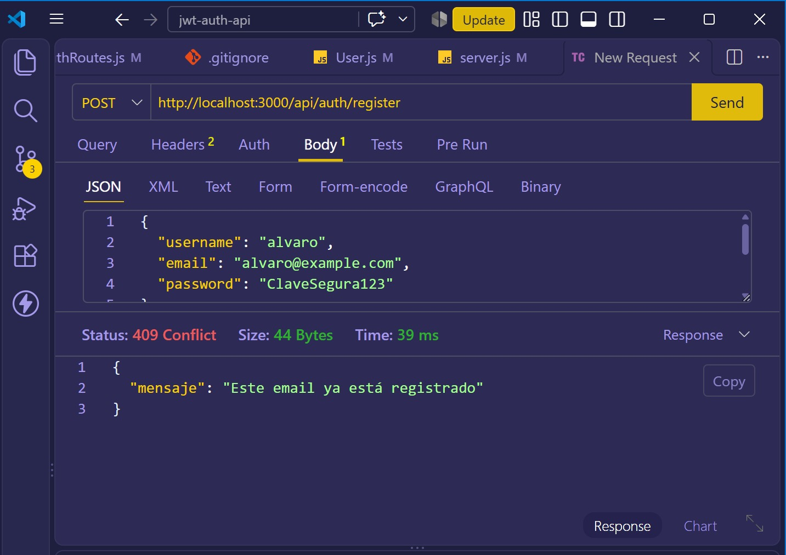
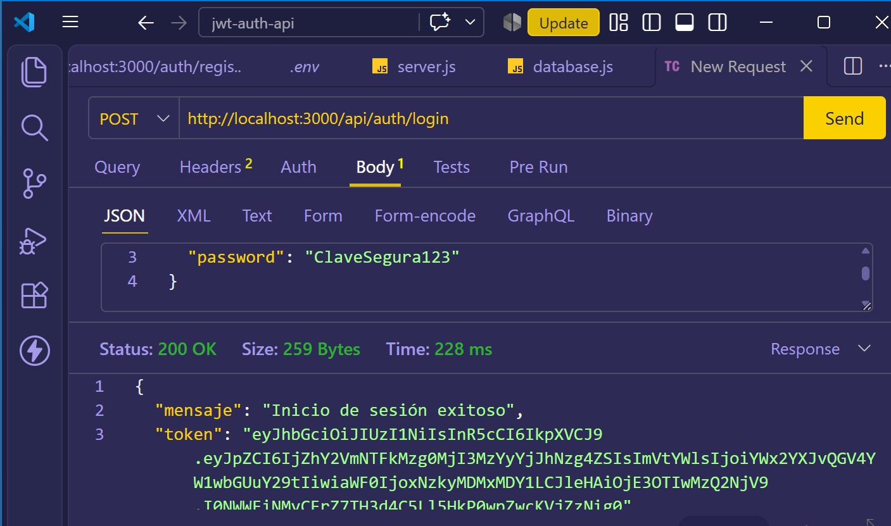
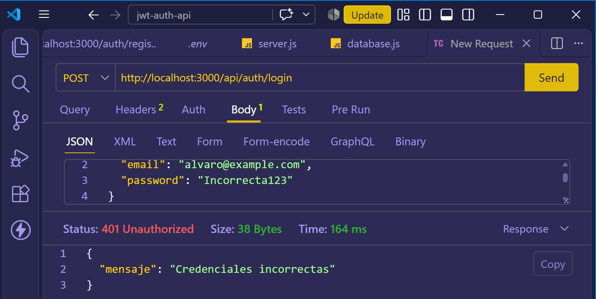
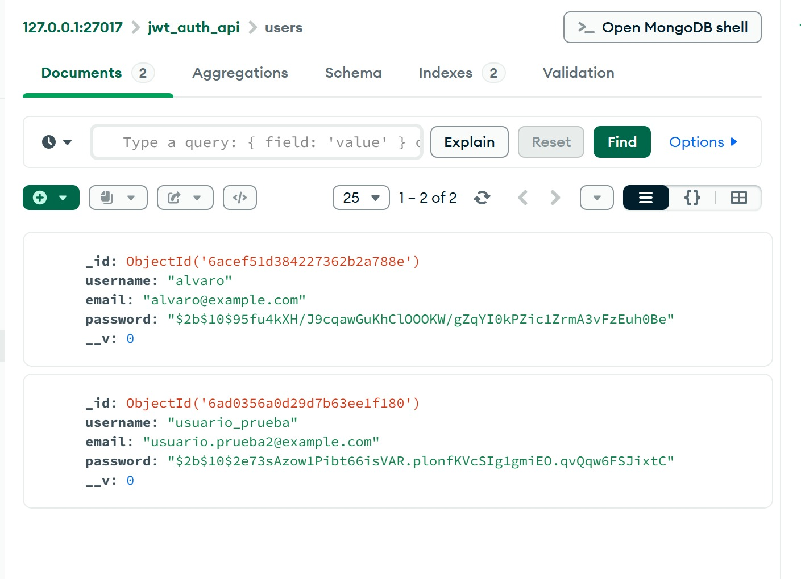

# Pruebas de autenticación con JWT

## Herramientas utilizadas

- Thunder Client para probar los endpoints.
- MongoDB Compass para verificar los usuarios almacenados.
- Node.js, Express, MongoDB, Mongoose, bcryptjs y jsonwebtoken.

## 1. Registro exitoso

**Endpoint:** `POST /api/auth/register`

**Resultado:** `201 Created`

El servidor registra un nuevo usuario y almacena su contraseña mediante bcrypt.

## 2. Email duplicado

**Endpoint:** `POST /api/auth/register`

**Resultado:** `409 Conflict`

El servidor impide registrar un usuario con un correo electrónico que ya existe.

## 3. Inicio de sesión exitoso

**Endpoint:** `POST /api/auth/login`

**Resultado:** `200 OK`

El servidor valida las credenciales y genera un token JWT.

## 4. Contraseña incorrecta

**Endpoint:** `POST /api/auth/login`

**Resultado:** `401 Unauthorized`

El servidor rechaza las credenciales incorrectas y no genera un token JWT.

## 5. Contraseñas protegidas

Se verificó en MongoDB Compass que los usuarios se almacenan en la colección `users` y que sus contraseñas están guardadas como hashes de bcrypt.

## Conclusión

Se implementaron y probaron correctamente las funcionalidades de registro de usuarios e inicio de sesión con JWT, incluyendo validación de correos duplicados, comprobación de contraseñas y almacenamiento seguro mediante bcrypt.